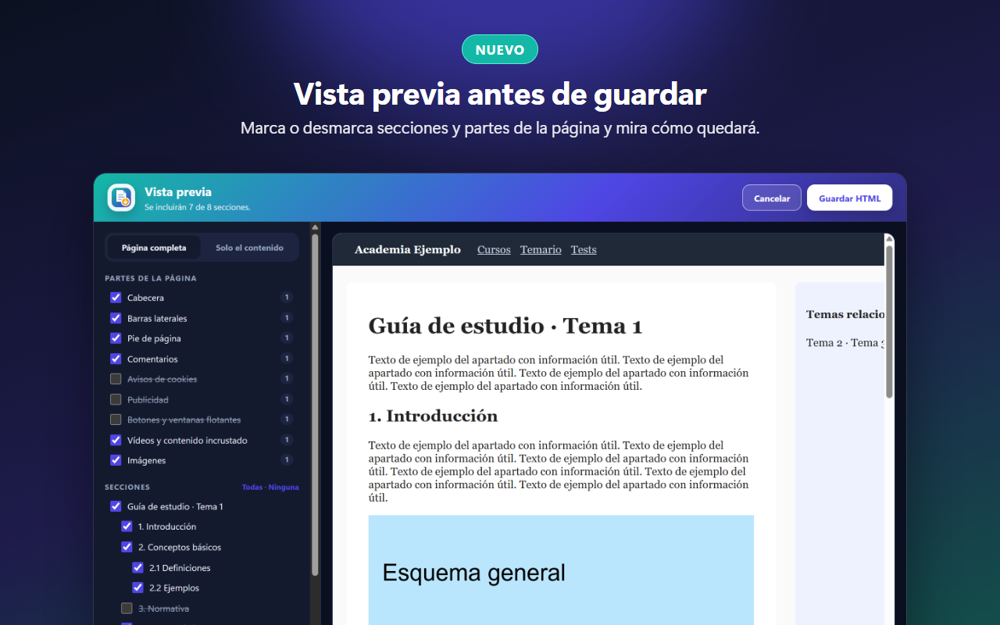
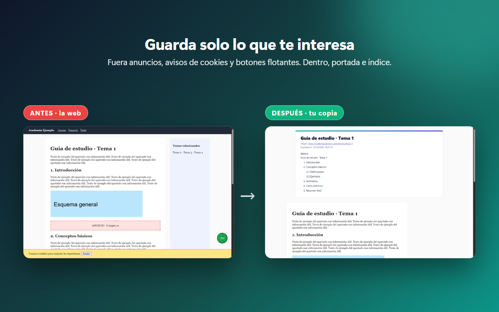
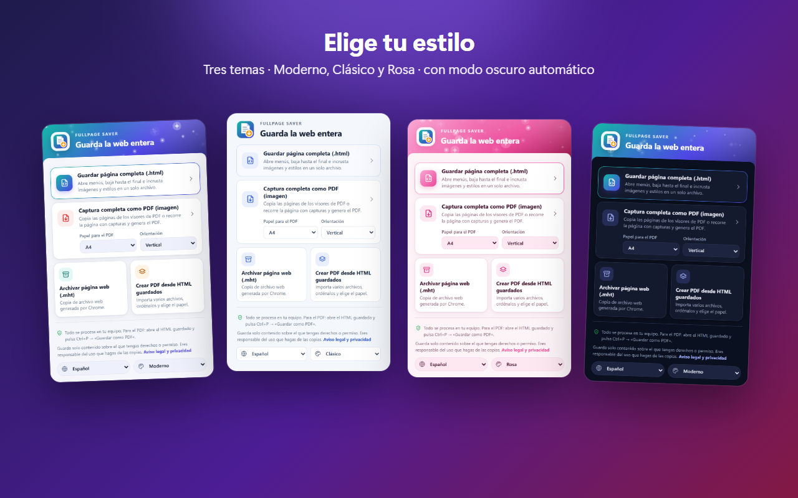

# FullPage Saver

**Extensión de Chrome para guardar páginas web completas en HTML o PDF**, tal y como se ven: abre menús, carga todo el contenido, quita anuncios y avisos de cookies, y te deja elegir qué guardar antes de generar el archivo.


> Manifest V3 · JavaScript puro, sin dependencias ni código remoto · 7 idiomas · todo se procesa en el equipo del usuario.

## Funciones

**Guardar una página**
- **HTML autocontenido** (estilo SavePage WE): un único `.html` con imágenes, estilos y fuentes incrustados; el contenido de los iframes del mismo origen va dentro, y cada `canvas` se guarda como imagen.
- **PDF por capturas** con **texto seleccionable**: recorre la página, une las capturas sin franjas ni barras repetidas y añade una capa de texto invisible para poder copiar y buscar.
- **Visores de PDF** (PDF.js y similares): copia cada página de su canvas a tamaño original, con su texto.
- **MHT** con la función nativa de Chrome.

**Antes de guardar: vista previa**
- Marcar o desmarcar **secciones** (por títulos) y **partes** de la página: cabecera, menús, barras laterales, pie, comentarios, cookies, publicidad, botones flotantes, vídeos, imágenes.
- **Modo lectura**: solo el contenido, con una tipografía cómoda.
- **Resaltar**, **quitar párrafos** y **añadir notas** directamente sobre la vista previa.
- Portada, índice, direcciones de los enlaces y nota personal.
- Nombre del archivo editable y **tamaño del PDF** (ligero, normal o máxima calidad).



**Más**
- **Varias pestañas** de una vez: un HTML o un PDF por pestaña, o todas en un único PDF.
- **Conversor de HTML guardados a PDF**, sin límite de archivos: añádelos uno a uno o una carpeta entera; un PDF por archivo (con su nombre original) o uno combinado.
- **Velocidad de captura** rápida, normal o lenta, y **repaso automático** de lo que no terminó de cargar (spinners, páginas en blanco).
- **Modo aplicación** para Gmail, Drive, Outlook…: no pulsa nada y recorre solo el panel principal.
- **Atajo de teclado**: Alt+Mayús+P guarda la pestaña en PDF.
- Tres **temas** (Moderno, Clásico y Rosa) con modo oscuro, y **7 idiomas**: español, català, English, français, português, Deutsch e italiano.

| Antes y después | Temas |
|---|---|
|  |  |

## Instalar desde el código

1. Descarga o clona este repositorio.
2. Abre `chrome://extensions` y activa el **Modo de desarrollador**.
3. Pulsa **Cargar descomprimida** y elige la carpeta `extension-chrome` (la que contiene `manifest.json`).
4. Fija FullPage Saver en la barra de extensiones.

Para cambiar el atajo de teclado: `chrome://extensions/shortcuts`.

## Permisos

| Permiso | Para qué |
|---|---|
| `activeTab` | Leer, recorrer y capturar la pestaña cuando el usuario pulsa un botón de la extensión. |
| `scripting` | Ejecutar en esa pestaña el código que abre menús, la recorre y copia su contenido. |
| `downloads` | Guardar el archivo generado y mantener su nombre. |
| `pageCapture` | Generar el archivo `.mht`. |
| `<all_urls>` (opcional) | Solo se pide con un botón: para incrustar recursos de otros dominios en el HTML y para leer otras pestañas en «Varias pestañas». |

No se envía nada a ningún servidor, no hay analítica ni código remoto. El aviso legal y la política de privacidad están en [`legal.html`](extension-chrome/legal.html).

## Estructura del repositorio

| Carpeta o archivo | Qué contiene |
|---|---|
| [`extension-chrome/`](extension-chrome) | El código de la extensión (lo que se carga en Chrome). |
| [`publicar-store/`](publicar-store) | Material para la Chrome Web Store: textos de la ficha, capturas, imágenes promocionales, vídeos y los ZIP de cada versión. |
| `exportar-vista-pdf.html` | Primera herramienta independiente para exportar a PDF páginas guardadas (anterior a la extensión). |

## Estructura del código

Dentro de `extension-chrome/`:

| Archivo | Qué hace |
|---|---|
| `manifest.json` | Declaración de la extensión (MV3), permisos y atajo de teclado. |
| `popup.html` / `popup.js` / `popup.css` | Menú de la extensión, idioma, tema y ajustes del PDF. |
| `save.html` / `save.js` | Ventana de progreso: prepara la página, la captura, genera el HTML o el PDF y lo descarga; también «Varias pestañas». |
| `review.js` / `review.css` | Vista previa: secciones, partes, modo lectura, marcas, portada e índice. |
| `pdfwriter.js` | Generador de PDF propio (imágenes JPEG + capa de texto) y descargas con nombre. |
| `pdf.html` / `pdf.js` / `pdf.css` | Conversor de HTML guardados a PDF. |
| `preview.html` / `preview.js` | Vista previa del conversor y descarga de los PDF. |
| `background.js` | Atajo de teclado y nombre de las descargas. |
| `i18n.js`, `legal-i18n.js`, `_locales/` | Textos en los 7 idiomas. |
| `theme.js` | Temas visuales y partículas. |

Los detalles de funcionamiento (cómo se detectan las secciones, la capa de texto del PDF, la velocidad de captura, los nombres de las descargas…) están en [`docs/DETALLES-TECNICOS.md`](extension-chrome/docs/DETALLES-TECNICOS.md).

## Crear el ZIP para la Chrome Web Store

```powershell
./extension-chrome/build-zip.ps1
```

Genera `fullpage-saver-<versión>.zip` en la raíz del repositorio con los archivos de la extensión (sin `docs/`, el script ni los archivos de Git). La versión se toma de `manifest.json`.

## Uso responsable

Guarda solo contenido sobre el que tengas derechos o permiso de su titular. El usuario es el único responsable del uso que haga de la extensión y de las copias que genere.

## Autor

Danny Medina Coronel · empresademkor@gmail.com

© 2026 Danny Medina Coronel. Todos los derechos reservados.
