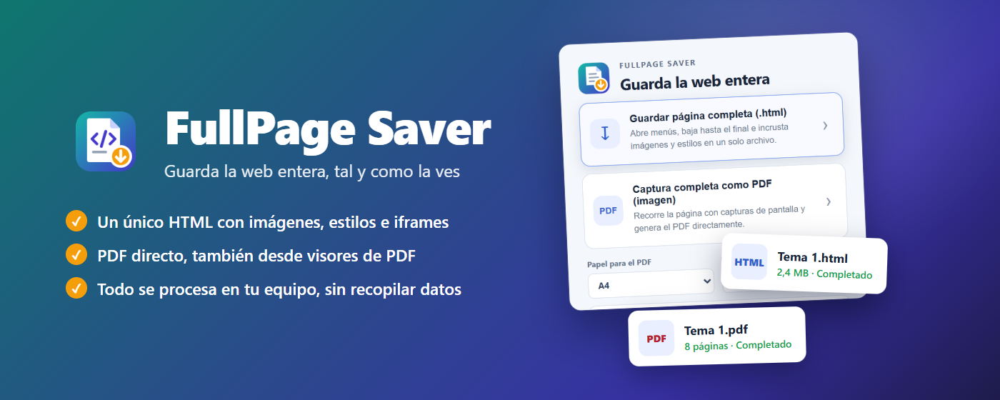
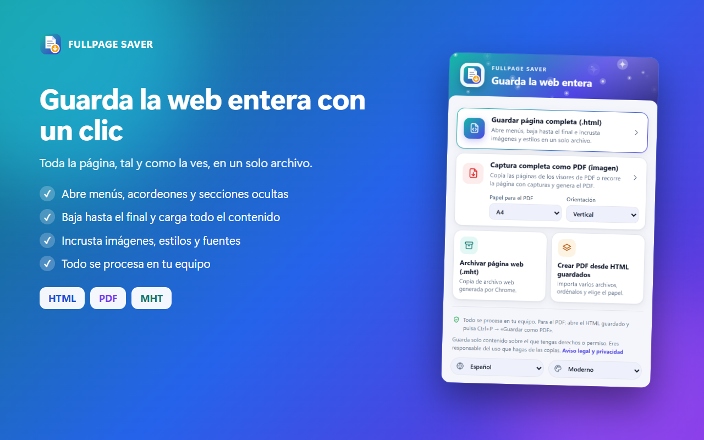
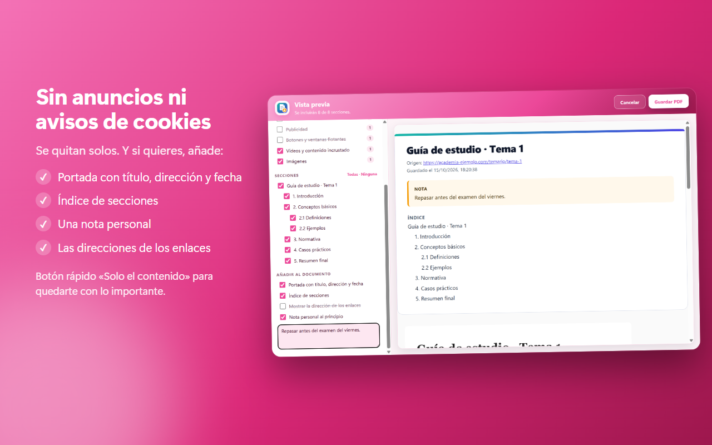
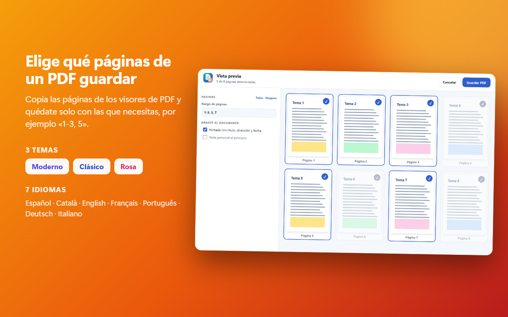
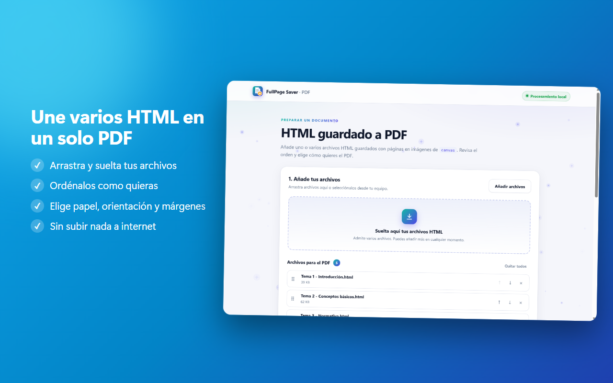
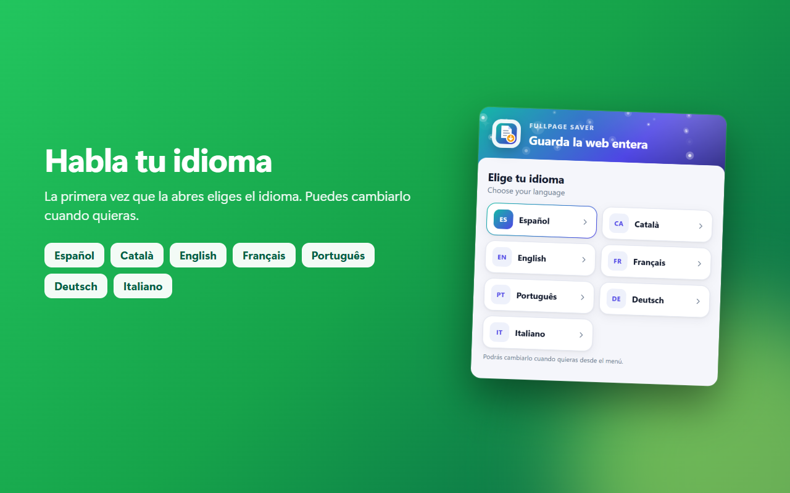

# FullPage Saver

**Extensión de Chrome para guardar páginas web completas en HTML o PDF**, tal y como se ven: abre menús, carga todo el contenido, quita anuncios y avisos de cookies, y te deja elegir qué guardar antes de generar el archivo.

 

   

**[Capturas](#capturas)** · **[Funciones](#funciones)** · **[Instalar](#instalar)** · **[Permisos](#permisos)** · **[Privacidad](#privacidad)** · **[Soporte](#soporte)**

> El repositorio contiene la información y los paquetes de instalación. El código fuente es privado.

🌐 **[Web oficial](https://fullpagesaver-extension.netlify.app)** · ▶ **[Vídeo de presentación](https://www.youtube.com/watch?v=SuRvwytMjKg)**

> Manifest V3 · JavaScript puro, sin dependencias ni código remoto · 7 idiomas · todo se procesa en el equipo del usuario.

## Capturas

| | |
|---|---|
|  Guarda la web entera con un clic |  Vista previa antes de guardar |
|  Sin anuncios ni avisos de cookies |  Elige qué páginas de un PDF guardar |
|  Antes y después: solo lo que te interesa |  Tres temas con modo oscuro |
|  Une varios HTML en un solo PDF |  7 idiomas |

## Funciones

**Guardar una página**
- **HTML autocontenido** (estilo SavePage WE): un único `.html` con imágenes, estilos y fuentes incrustados; el contenido de los iframes del mismo origen va dentro, y cada `canvas` se guarda como imagen.
- **PDF por capturas** con **texto seleccionable**: recorre la página, une las capturas sin franjas ni barras repetidas y añade una capa de texto invisible para poder copiar y buscar.
- **Visores de PDF** (PDF.js y similares): copia cada página de su canvas a tamaño original, con su texto.
- **MHT** con la función nativa de Chrome.

**Antes de guardar: vista previa**
- Marcar o desmarcar **secciones** (por títulos) y **partes** de la página: cabecera, menús, barras laterales, pie, comentarios, cookies, publicidad, botones flotantes, vídeos, imágenes.
- **Modo lectura**: solo el contenido, con una tipografía cómoda.
- **Resaltar**, **quitar párrafos** y **añadir notas** directamente sobre la vista previa.
- Portada, índice, direcciones de los enlaces y nota personal.
- Nombre del archivo editable y **tamaño del PDF** (ligero, normal o máxima calidad).

**Más**
- **Varias pestañas** de una vez: un HTML o un PDF por pestaña, o todas en un único PDF.
- **Conversor de HTML guardados a PDF**, sin límite de archivos: añádelos uno a uno o una carpeta entera; un PDF por archivo (con su nombre original) o uno combinado.
- **Velocidad de captura** rápida, normal o lenta, y **repaso automático** de lo que no terminó de cargar (spinners, páginas en blanco).
- **Modo aplicación** para Gmail, Drive, Outlook…: no pulsa nada y recorre solo el panel principal.
- **Atajo de teclado**: Alt+Mayús+P guarda la pestaña en PDF.
- Tres **temas** (Moderno, Clásico y Rosa) con modo oscuro, y **7 idiomas**: español, català, English, français, português, Deutsch e italiano.

| Antes y después | Temas |
|---|---|
|  |  |

## Instalar

Hay dos formas:

### Opción 1: desde la Chrome Web Store (recomendada)

Entra en **[FullPage Saver en la Chrome Web Store](https://chromewebstore.google.com/detail/fullpage-saver-%E2%80%93-guardar/igjphghlkmidddmnmlmdnhnepehpoena)** y pulsa **Añadir a Chrome**. Se actualiza sola cada vez que sale una versión nueva.

### Opción 2: manualmente, con el paquete del Release

1. Ve a **[Releases](../../releases/latest)** y descarga `fullpage-saver-2.9.7.zip`.
2. Descomprime el ZIP en una carpeta que no vayas a borrar (Chrome la lee desde ahí).
3. Abre `chrome://extensions` y activa el **Modo de desarrollador** (arriba a la derecha).
4. Pulsa **Cargar descomprimida** y elige la carpeta descomprimida (la que contiene `manifest.json`).
5. Fija FullPage Saver en la barra de extensiones.

Instalada así no se actualiza sola: para una versión nueva, descarga el ZIP del último Release, sustituye la carpeta y pulsa el botón de recargar de la extensión en `chrome://extensions`.

Para cambiar el atajo de teclado: `chrome://extensions/shortcuts`.

## Permisos

| Permiso | Para qué |
|---|---|
| `activeTab` | Leer, recorrer y capturar la pestaña cuando el usuario pulsa un botón de la extensión. |
| `scripting` | Ejecutar en esa pestaña el código que abre menús, la recorre y copia su contenido. |
| `downloads` | Guardar el archivo generado y mantener su nombre. |
| `pageCapture` | Generar el archivo `.mht`. |
| `<all_urls>` (opcional) | Solo se pide con un botón: para incrustar recursos de otros dominios en el HTML y para leer otras pestañas en «Varias pestañas». |

## Privacidad

**Resumen:** todo se procesa en tu equipo. FullPage Saver **no recopila, almacena, transmite ni vende datos personales**, no usa analítica, publicidad, cookies de seguimiento ni código remoto.

- El contenido de las páginas que decides guardar se procesa solo en tu navegador y se guarda en tu equipo mediante la descarga que tú confirmas.
- Para incrustar imágenes, estilos y fuentes en la copia, la extensión los descarga directamente de los servidores de origen de la página, igual que al visitarla (esos servidores ven tu IP como en cualquier visita).
- Los datos temporales del conversor PDF, el idioma, el tema y el número de guardados se quedan en el almacenamiento local de la extensión y se borran con **Eliminar datos temporales** o desinstalándola.
- Responsable: Danny Medina Coronel · [empresademkor@gmail.com](mailto:empresademkor@gmail.com). Puedes ejercer tus derechos RGPD escribiendo a ese correo.

Política completa y aviso legal: **[PRIVACY.md](PRIVACY.md)**.

## Soporte

¿Algo no funciona o tienes una duda? Hay tres vías, de la más rápida a la más completa:

1. **Preguntas frecuentes** (justo debajo): resuelven la mayoría de los casos.
2. **Una incidencia en GitHub**: [abre una aquí](https://github.com/dannymedinacoronel/FullPagesaver-Extension/issues/new?template=problema.md). Es la mejor opción para fallos, porque queda registrado y otros usuarios pueden verlo.
3. **Correo**: [empresademkor@gmail.com](mailto:empresademkor@gmail.com) para consultas privadas, privacidad o sugerencias.
4. **Chrome Web Store**: puedes dejar tu valoración o consulta en la [ficha de la extensión](https://chromewebstore.google.com/detail/fullpage-saver-%E2%80%93-guardar/igjphghlkmidddmnmlmdnhnepehpoena).

**Para poder ayudarte rápido, incluye:** la versión de FullPage Saver (en `chrome://extensions`), tu versión de Chrome (`chrome://settings/help`), tu sistema operativo, qué esperabas que pasara y qué pasó, y los pasos para repetirlo. No envíes contraseñas ni datos personales.

### Preguntas frecuentes

<b>El PDF sale con partes en blanco o faltan páginas</b>

Pon la **velocidad de captura en «Lenta»** (en el popup, junto al papel y la orientación): da mucho más tiempo a las webs y documentos que tardan en cargar. Además, mantén Chrome en primer plano y **no cambies de pestaña** mientras captura. El repaso automático vuelve a capturar solo lo que no terminó de cargar (hasta 10 s de espera por zona).

<b>Gmail, Drive u Outlook no se guardan bien</b>

Usa el **Modo aplicación**: no pulsa botones y recorre solo el panel principal.

<b>Las imágenes o estilos no se ven en el HTML guardado</b>

Al guardar en HTML la extensión pide, con un botón, acceso a todos los sitios para descargar recursos de otros dominios. Si lo rechazas, esos recursos quedan enlazados (necesitan conexión). Vuelve a guardar y acepta el permiso.

<b>El archivo se descarga con un nombre raro (como «cb5d5c0d-….pdf»)</b>

Suele pasar si otra extensión interviene en las descargas (gestores de descargas, antivirus…): Chrome ignora el nombre que pide FullPage Saver. Prueba a desactivar esa extensión o renombra el archivo.

<b>No puedo guardar una página de Chrome (`chrome://…`) ni la Web Store</b>

Chrome no permite que las extensiones lean sus páginas internas ni la tienda. Es una limitación del navegador.

<b>¿Cómo guardo solo una parte de la página?</b>

En la **vista previa** marca o desmarca secciones (por títulos) y partes: cabecera, menús, barras laterales, pie, comentarios… O usa **Solo el contenido** / **Modo lectura**.

<b>¿Dónde queda lo que guardo?</b>

Chrome abre el diálogo «Guardar como» para que elijas la carpeta. El conversor de HTML a PDF en modo «un PDF por archivo» guarda sin preguntar en la carpeta **FullPage Saver** de Descargas.

<b>¿Cómo borro los datos temporales?</b>

Usa **Eliminar datos temporales** dentro de la extensión al terminar; la vista previa se guarda en el almacenamiento local de la extensión y no sale del equipo.

<b>¿Puedo cambiar el atajo de teclado?</b>

Sí, en `chrome://extensions/shortcuts`. Por defecto `Alt+Mayús+P` guarda la pestaña en PDF.

<b>Cómo actualizar si lo instalé manualmente</b>

Descarga el ZIP del [último Release](https://github.com/dannymedinacoronel/FullPagesaver-Extension/releases/latest), sustituye la carpeta y pulsa recargar en `chrome://extensions`. Desde la Chrome Web Store se actualiza sola.

## Uso responsable

Guarda solo contenido sobre el que tengas derechos o permiso de su titular. El usuario es el único responsable del uso que haga de la extensión y de las copias que genere.

## Autor

Danny Medina Coronel · empresademkor@gmail.com

© 2026 Danny Medina Coronel. Todos los derechos reservados.
